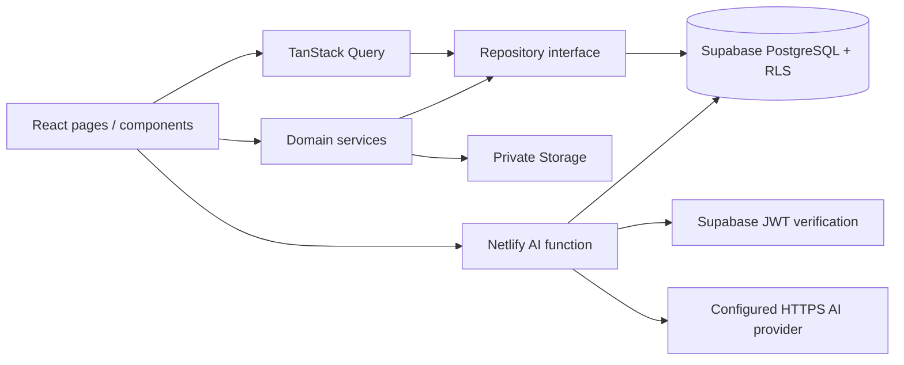
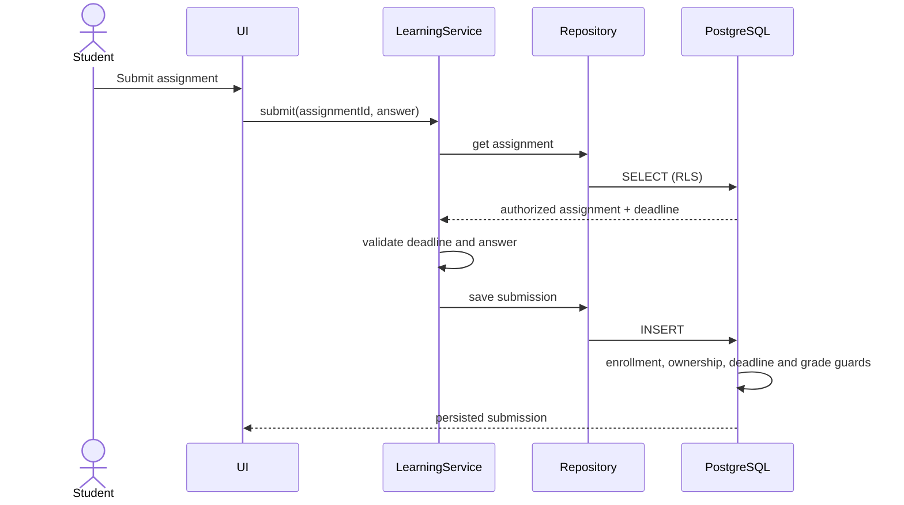
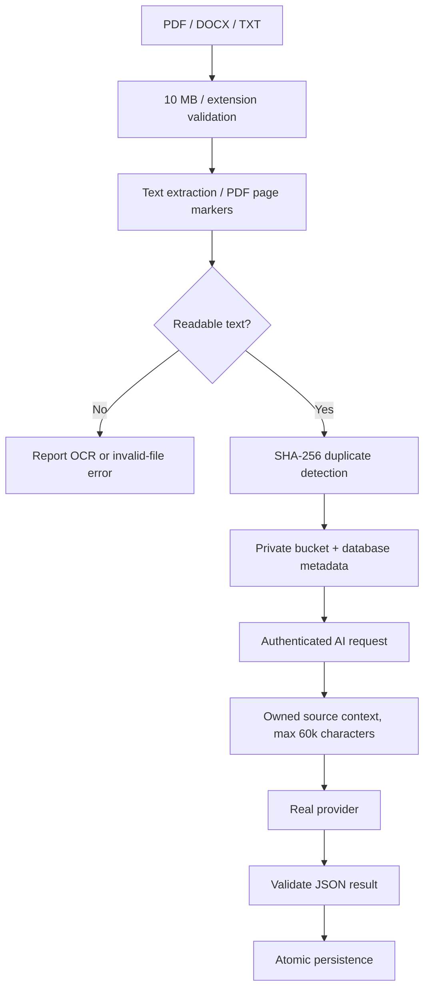

# Three-layer architecture

## Presentation

`src/pages/` contains public, student, teacher and administrator screens. `src/components/ui/` implements Button, Card, Badge, Empty, Loading, PageTitle, SectionTitle and accessible Radix Modal. `src/components/layout/` contains the responsive shell, sidebar, language picker and route boundaries. React Hook Form + Zod drive authentication validation; native constraint validation and domain services validate content forms. Recharts renders database-derived activity and scores. i18next uses complete parallel KK/RU/EN resources. TanStack Query caches read operations and invalidates them after writes.

## Business logic

`src/domain/rules.ts` defines credentials/course/quiz schemas, deadline and upload validation, role checks and quiz scoring reference logic. `src/services/learning.ts` coordinates enrollments, course saving, submissions, grading and completions. `src/services/documents.ts` extracts PDF.js/Mammoth/TXT content, fingerprints uploads, coordinates storage/metadata and handles deletion/download. `src/services/ai.ts` attaches the current JWT and handles backend errors. `netlify/functions/ai.ts` validates requests, verifies JWTs with Supabase, obtains authorized context, calls an HTTPS OpenAI-compatible provider, validates structured outputs and persists them via RPC.

## Data access

`src/repositories/data.ts` defines an injectable Repository and Supabase implementation with named, parameterized query methods and aggregate RPC adapters. Generic operations are table-allowlisted; database RLS remains the authorization authority. `src/repositories/demo.ts` is a separate read-only implementation. PostgreSQL constraints, triggers, RLS and RPCs implement persistence invariants and atomic operations that cannot safely be delegated to a browser. Supabase SDK storage calls are confined to services or attachment adapters in management forms.

Some screen query composition and attachment adapters currently live in page modules. These are documented refactoring candidates rather than a claim of perfect separation. Security-sensitive rules remain enforced in SQL.

No service-role key is required in the application: the function forwards an authenticated JWT using the public Supabase key. Error logs contain operation categories, never credentials, document text or provider bodies. PostgreSQL is the final authority on score, grade and role mutation.
